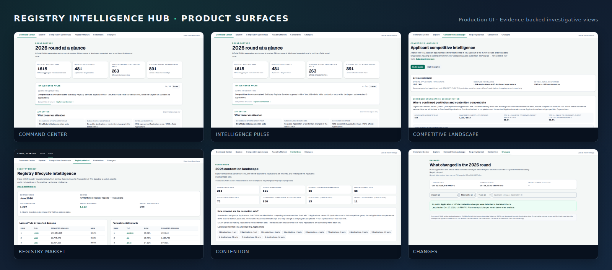
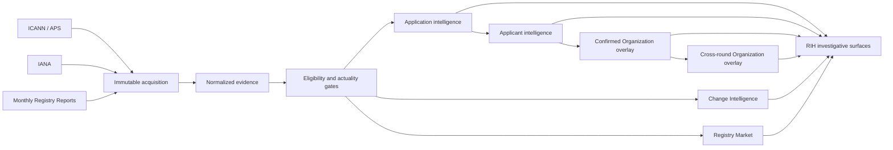

<p align="center">
  
</p>

<p align="center">
  <strong>Registry Intelligence Hub</strong> turns fragmented ICANN and IANA publications into<br/>
  defensible registry-industry intelligence.
</p>

<p align="center">
  
  
  
  
  
  
</p>

---

## What is RIH?

**Registry Intelligence Hub (RIH)** is an evidence-backed research and competitive intelligence platform for ICANN gTLD rounds.

RIH connects public application, applicant, contention, historical, organization, change-monitoring, and registry-market evidence into one investigative surface. It is designed to make defensible conclusions easier **without** collapsing Applicant, Organization, Registry Operator, RSP, registrar, DNS provider, or corporate-parent identities into claims the evidence does not support.

RIH preserves the distinction between what is **known**, **partial**, **candidate**, **ambiguous**, **blocked**, or **unavailable**. That discipline is the product — not an afterthought.

<p align="center">
  
</p>

## Live Intelligence Snapshot

Accepted production facts (Reveal Day 2026 + Registry Market baseline):

| Signal | Value |
| --- | ---: |
| Official 2026 Applications | **1,615** |
| Official Applicants | **481** |
| Official initial contention sets | **263** |
| Official initial contention memberships | **891** |
| RIH represented Application coverage | **1,614 / 1,615** |
| Registry Market baseline TLDs | **1,319** |
| Registry Market reports available | **1,113** |
| Registry Market explicitly unavailable | **206** |

These are official aggregates, coverage disclosures, and publication-availability counts — **not** market share, customers, wins, pipeline, or opportunity claims.

## What RIH Answers

- How concentrated is the 2026 application landscape?
- Which confirmed Organizations map across multiple Applicant legal entities?
- Which Organizations repeatedly meet each other in official contention?
- Where does GoDaddy Registry Services appear in the competitive landscape?
- How does the 2026 round structurally differ from 2012?
- What has changed since the latest accepted public-source snapshot?
- Which TLDs show the strongest publicly reported registry-market scale and movement?
- Which conclusions are currently blocked because evidence maturity is insufficient?

## Product Surfaces

| Surface | Route | Purpose |
| --- | --- | --- |
| **Command Center** | `/` | Round posture, Intelligence Pulse, structural change, attention signals |
| **Explore** | `/explore` | Application-level evidence investigation (2026 + historical datasets) |
| **Competitive Landscape** | `/competitive-landscape` | Applicant / confirmed-Organization concentration and competitive structure |
| **Registry Market** | `/market` | ICANN Monthly Registry Report baseline and registrar/TLD trends |
| **Contention** | `/contention` | Official initial contention structure and relationship intelligence |
| **Changes** | `/changes` | Public-source Change Intelligence |
| **Historical / Cross-round** | `/cross-round`, `/historical-cohorts` | 2012 vs 2026 structural and identity views |
| **Data & Methodology** | `/data-health` | Coverage, provenance, eligibility, source health |

Hub base path in deployed environments: `/tools/registry-intelligence-hub`.

## The RIH Trust Contract

| Rule | Meaning |
| --- | --- |
| **Applicant ≠ Organization** | Legal-name Applicants are not automatically corporate parents or portfolios |
| **MISSING ≠ zero** | An unavailable report or blocked metric is not treated as zero activity |
| **Official contention ≠ exact-string grouping** | Official initial contention is ICANN’s membership structure, not a string-equality inference |
| **Candidate mapping ≠ confirmed Organization** | Only steward-accepted mappings enter confirmed Organization intelligence |
| **Public RSP capability ≠ selected RSP** | Public Main-RSP signals never imply a selected or contracted provider |
| **Unmatched ≠ new** | Lack of a cross-round match is not proof of a new participant |
| **Partial coverage ≠ complete round coverage** | Represented rows (1,614) are disclosed separately from official totals (1,615) |

RIH intentionally **omits or qualifies** intelligence when evidence maturity is insufficient. That restraint is a product differentiator — not a missing feature.

## Intelligence Architecture



Organization resolution **enriches** Applicant intelligence; it is not a prerequisite for Applicant intelligence. Confirmed Organization overlays and cross-round Organization overlays remain evidence-gated. RIH does not invent unsupported joins such as Registrar → Organization or RSP → Application.

**Command Center Intelligence Pulse** is a deterministic, eligibility-gated interpretation layer (not AI-generated, not an LLM feature, not a recommendation engine). See [`docs/2026-command-center-intelligence.md`](docs/2026-command-center-intelligence.md).

## Current Production State

| Layer | Status |
| --- | --- |
| Repository | Product README and operational docs may advance independently of deployed application source |
| Production application source | `a1124b71093333fc8492299885871d0bd0345aca` (detached) |
| Reveal Day applications + official contention | **LIVE** (`REAL_SOURCE_READY`) |
| Competitive Landscape | **LIVE** |
| Organization concentration / contention-pair intelligence | **LIVE** (confirmed-subset disclosed) |
| Change Intelligence | **LIVE** |
| Registry Market publication | **LIVE** — baseline **1,319 / 1,113 / 206** |
| Command Center Intelligence Pulse | **LIVE** |
| MRR refresh automation | **NOT INSTALLED** |

Production URL prefix: `/tools/registry-intelligence-hub` (Next.js on loopback `127.0.0.1:43123`).

README showcase based on documentation checkpoint `9e18b15a149c05c69b987bbc3798f86c782b8321`.

> Repository documentation/presentation commits may be ahead of the deployed application source. Production remains explicitly pinned to the accepted detached application SHA shown above; docs-only README changes do not require redeployment.

### Visual status

- ✅ Reveal Day applications live
- ✅ Official contention live
- ✅ Competitive Landscape live
- ✅ Organization concentration live
- ✅ Change Intelligence live
- ✅ Registry Market live
- ✅ Intelligence Pulse live
- ⚠️ MRR refresh automation not installed

Historical Reveal Day promotion event (2026-10-08) remains documented in [`docs/2026-reveal-day-production-closeout.md`](docs/2026-reveal-day-production-closeout.md); that document’s original promotion SHA is historical, not current application HEAD.

---

## Quick Start

Requires **Node.js >= 22.0.0** (`package.json` `engines`). Next.js accepts >=20.9.0, but this repo’s tooling (Vitest 5, Playwright) warns on Node 20 — use **Node 22** for install, verify, build, and PM2.

```bash
npm install
npm run dev
```

Open:

- `http://localhost:3000/tools/registry-intelligence-hub` — Command Center
- `http://localhost:3000/tools/registry-intelligence-hub/explore` — Explore
- `http://localhost:3000/tools/registry-intelligence-hub/competitive-landscape` — Competitive Landscape
- `http://localhost:3000/tools/registry-intelligence-hub/market` — Registry Market

State rehearsals: `?state=loading`, `?state=empty`, `?state=error`.

Local/dev default without claim actuality remains the synthetic 12-application rehearsal fixture — **not** the official 2026 Reveal Day publication.

## Verify

```bash
npm run verify
npm run smoke
```

- `npm run verify` — lint, TypeScript, deterministic fixture/hash tests, production build
- `npm run smoke` — boots a fresh `next start` and checks Hub routes **and** that every client chunk referenced by Command Center resolves

> **Operational warning:** a stale `next-server` left running across `next build` otherwise 404s chunks and triggers the isolated Hub error boundary. Restart preview after build (`npm run hub:production`) so HTML and `/tools/registry-intelligence-hub/_next/static` stay in sync.

On hosts without the Cursor Project Store, Project Store markdown-contract tests are **skipped** (not failed). To require them, set `REGISTRY_HUB_PROJECT_DOCS_ROOT` and run `npm run verify:project-docs`.

---

## Repository / data architecture

RIH separates **immutable acquisition**, **normalized evidence**, **eligibility/actuality gates**, and **investigative UI**. Browser fixtures, Reveal Day publications, Change Intelligence stores, and Registry Market publication trees are intentionally distinct — Market data does not live under APS/Reveal trees.

<details>
<summary><strong>Production preview &amp; rehearsal deploy</strong></summary>

### Production preview (Cloud / manual QA)

After any `npm run build` or `npm run verify`, restart the preview server:

```bash
npm run hub:production
```

Then open `http://127.0.0.1:43123/tools/registry-intelligence-hub`.

### Production rehearsal deploy (ForgeForward / Ubuntu)

Full operator contract (PM2, nginx, ToolsPage catalog, env, smoke): Project store `docs/production-rehearsal-hub-deploy.md` and `docs/rih-basepath-shared-vps-deploy.md`.

Minimal rehearsal:

```bash
npm ci
npm run verify
# Rehearsal default — do not export REGISTRY_HUB_* claim/payload pins; remove any stray promotion file:
rm -f .data/reveal-2026/claim-actuality-state.json
npm run smoke
```

Run the Hub behind ForgeForward at `/tools/registry-intelligence-hub` after loopback smoke passes. **Live Tools catalog:** add a card in ForgeForward `ToolsPage.jsx` and rebuild the Vite frontend — not `features.registryIntelligenceHubCatalog` (repo `src/config/features.ts` is Hub-internal only).

**srv766238:** PM2 via `deploy/ecosystem.config.cjs.example`, cwd `/root/registry_hub`. Run `npm run build` then `npm run start -- -H 127.0.0.1 -p 43123` under PM2 — do not use `hub:production` under a process manager. Run **`npm run smoke` before first PM2 start** (or stop PM2 before later smoke — smoke uses port 43123).

</details>

<details>
<summary><strong>Reveal Day activation &amp; claim actuality</strong></summary>

- **2026 claim actuality (browser)** — Hub routes load promoted state via `loadPromotedClaimActualityState()` (`src/lib/claim-actuality-server.ts`). Eligibility resolves through `resolveHubMetricEligibility()`. Production may supply on-disk JSON (default `.data/reveal-2026/claim-actuality-state.json`) or `REGISTRY_HUB_CLAIM_ACTUALITY_STATE_JSON`. Env JSON takes precedence. **Do not set `REGISTRY_HUB_CLAIM_ACTUALITY_STATE_PATH` to a nonexistent file** (hard-fails).
- **2026 application rows** — When claim actuality is `REAL_SOURCE_READY` and payload matches `snapshotId` + `snapshotContentHash`, the Hub activates Browser 2.x. Prefer `REGISTRY_HUB_APPLICATION_PAYLOAD_PATH`. **`REAL_SOURCE_READY` + missing/mismatched payload fails closed (no rehearsal fallback).**
- Canonical handoff / historical promotion event: [`docs/2026-reveal-day-production-closeout.md`](docs/2026-reveal-day-production-closeout.md)
- Activation contract: [`docs/2026-publication-2x-activation.md`](docs/2026-publication-2x-activation.md)

Approved **2012** comparison facts and eligibility gates live in `src/comparison/` (`metric-eligibility-catalog/2.0.0`, `historical-2012-ui-adapter/1.0.0`). Cross-round org identity uses `cross-round-identity/1.0.0` (`npm run normalize -- cross-round-identity`).

</details>

<details>
<summary><strong>Source inventory and snapshot pipeline</strong></summary>

`src/pipeline/` is a typed, versioned registry of authoritative public ICANN/IANA sources plus a local CLI that fetches, validates, and immutably stores raw source bytes. It does not feed browser fixtures directly — handoff is via `listHandoff()` / `npm run pipeline -- handoff`.

```bash
# Offline by default — fixture-backed; safe with no network
npm run pipeline -- list
npm run pipeline -- fetch --all
npm run pipeline -- snapshots
npm run pipeline -- verify
npm run pipeline -- handoff

# Opt-in live fetch — always point --root outside the repo
npm run pipeline -- fetch --all --mode live --root /tmp/source-pipeline-live
```

- Content-addressed SHA-256 blobs under `.data/source-pipeline/blobs/` (gitignored)
- Append-only per-source manifests under `.data/source-pipeline/manifests/`
- No fetched production payload is committed — only hand-authored fixtures in `src/pipeline/fixtures/`

</details>

<details>
<summary><strong>Offline normalization (2012)</strong></summary>

`src/normalization/` is a round-neutral, fixture-only normalization foundation: raw snapshot refs → parsed records → observations → normalized entities, with immutable override replay and content-addressed builds.

```bash
npm run normalize -- list-bundles
npm run normalize -- normalize --bundle icann2012-representative-v1
npm run normalize -- normalize --bundle icann2012-reveal-day-v1
npm run normalize -- report
npm run normalize -- verify --bundle icann2012-reveal-day-v1
npm run normalize -- cross-round-identity
```

- `icann2012-reveal-day-v1` — **1,930** Reveal Day applications from preserved CSV + official contention PDF extraction
- Builds under `.data/normalization/builds/<buildId>/` (gitignored)

Acquisition notes: `scripts/acquire-icann2012-reveal-day.md`

</details>

<details>
<summary><strong>Phase 0 / safety boundaries</strong></summary>

- Repo `features.registryIntelligenceHubCatalog` is Hub-internal only; it does **not** gate the live ForgeForward Tools page.
- No production database, authentication, or external write integration is used by the Hub itself.
- Immutable fixture metadata and hashes live in `src/data/fixtures/manifest.json`.
- RSP acquisition tooling and sanitized fixtures exist in-tree; a mapping or crawler result never becomes an approved fact automatically.
- Registry Market MRR scheduler remains **NOT INSTALLED** — publication is a static accepted baseline.

</details>

## Deep-Dive Documentation

| Domain | Start here |
| --- | --- |
| **Product intelligence** | [`docs/2026-command-center-intelligence.md`](docs/2026-command-center-intelligence.md) |
| **Evidence / Reveal Day** | [`docs/2026-reveal-day-production-closeout.md`](docs/2026-reveal-day-production-closeout.md) · [`docs/2026-aps-reveal-day-source-contract.md`](docs/2026-aps-reveal-day-source-contract.md) |
| **Organizations** | [`docs/2026-organization-resolution.md`](docs/2026-organization-resolution.md) · [`docs/organization-concentration.md`](docs/organization-concentration.md) |
| **Contention** | [`docs/contention-intelligence.md`](docs/contention-intelligence.md) · [`docs/organization-contention-pairs.md`](docs/organization-contention-pairs.md) |
| **Change Intelligence** | [`docs/change-intelligence.md`](docs/change-intelligence.md) |
| **Registry Market** | [`docs/market-baseline-publication.md`](docs/market-baseline-publication.md) |
| **Historical / cross-round** | [`docs/cross-round-structural-intelligence.md`](docs/cross-round-structural-intelligence.md) · [`docs/historical-cohort-intelligence.md`](docs/historical-cohort-intelligence.md) |
| **Competitive Landscape** | [`docs/participant-competitive-intelligence.md`](docs/participant-competitive-intelligence.md) |
| **Operations** | [`docs/2026-publication-2x-activation.md`](docs/2026-publication-2x-activation.md) · [`docs/2026-publication-2x-promotion-contract.md`](docs/2026-publication-2x-promotion-contract.md) |

> This repository documents a live intelligence platform. It does **not** claim the broader RIH product roadmap is complete.
